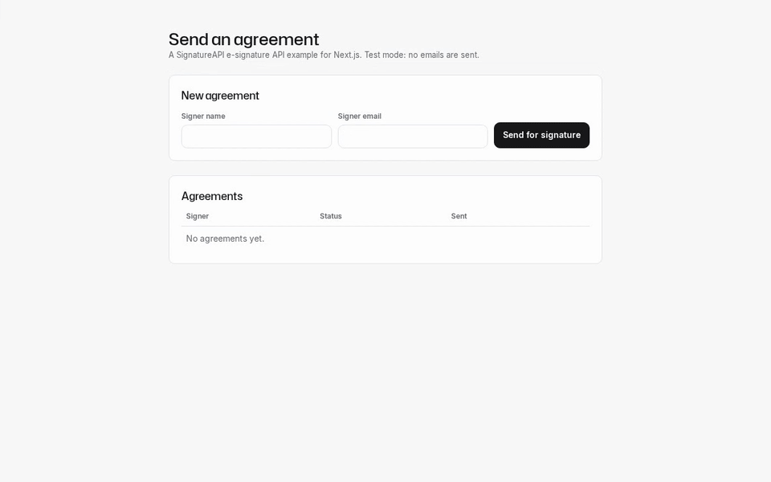
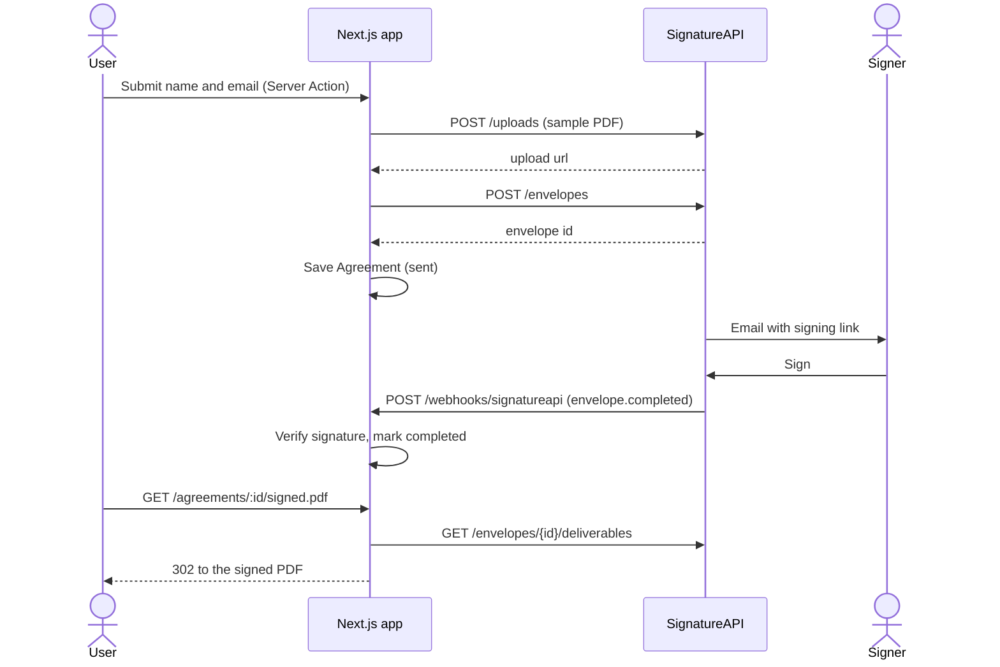

# SignatureAPI Next.js starter

A Next.js template for sending documents for signature with the SignatureAPI e-signature API.

[](docs/media/demo.mp4)

## What it does

One page, no login:

1. **Send.** Enter a signer's name and email. The app uploads `assets/sample-agreement.pdf`, creates an envelope, and saves an `Agreement` with status `sent`.
2. **Sign.** SignatureAPI emails the signer a link. The app never handles it.
3. **Track.** A webhook verifies each event and updates the status to `completed`, `rejected`, `failed` or `canceled`.
4. **Download.** A completed agreement links to its signed PDF. The app fetches a fresh download URL from SignatureAPI each time.

## Use this template

Select **Use this template** on GitHub, or clone the repo. Then follow the quickstart.

## Quickstart

You need Node.js 24 or later and a SignatureAPI account.

```bash
npm install
npx --yes signatureapi init --env-path .env.local
```

`init` writes a test API key to `.env.local` as `SIGNATUREAPI_KEY`. See `.env.local.example`.

Run the app:

```bash
npm run dev
```

In another terminal, forward test webhooks to the app:

```bash
npx --yes signatureapi listen --env-path .env.local --forward-to http://127.0.0.1:3000/webhooks/signatureapi
```

`listen` writes `SIGNATUREAPI_WEBHOOK_SECRET` to `.env.local`.

Open http://localhost:3000. Test mode sends no emails.

The app listens on port 3000. Set `PORT` to change it. The SQLite database is `sqlite.db`; set `DATABASE_URL` to use another file.

## How it works



The two files to read first:

- [`lib/signatureapi.ts`](lib/signatureapi.ts): every SignatureAPI call (`uploadDocument`, `createEnvelope`, `listDeliverables`). Add places, recipients or envelope options here.
- [`app/webhooks/signatureapi/route.ts`](app/webhooks/signatureapi/route.ts): verifies each webhook and maps event types to statuses. Add an event here.

The form's Server Action is in [`app/actions.ts`](app/actions.ts). The `Agreement` table is in [`lib/db/schema.ts`](lib/db/schema.ts), with Drizzle migrations in `drizzle/`. They run when the server starts.

## AI agents

The repo comes with the SignatureAPI agent skills and MCP server, pinned to one commit of [signatureapi/skills](https://github.com/signatureapi/skills):

- Claude Code: the `signatureapi` plugin in `.claude/settings.json` (skills and MCP).
- Codex, Cursor, Copilot and others: the same skills in `.agents/skills/`, plus `.cursor/mcp.json` and `.codex/config.toml` for MCP.

To move the pin, run `scripts/update-agent-skills.sh <commit-sha>`. [`AGENTS.md`](AGENTS.md) has the rules agents follow in this repo.

## Tests

```bash
npm run lint
npm test
```

Unit tests use Vitest and mock every SignatureAPI call. They cover the webhook, the envelope request, the form action and the signed PDF redirect.

[`e2e/`](e2e/) has one end-to-end test against SignatureAPI test mode. It needs your test key and `signatureapi listen`. See [`e2e/README.md`](e2e/README.md).

## Going to production

- Use a live API key in your production environment.
- Register your deployed webhook URL in the [SignatureAPI dashboard](https://dashboard.signatureapi.com/settings/webhooks) and set its signing secret as `SIGNATUREAPI_WEBHOOK_SECRET`.
- Add authentication for your users. This template has none.
- Download and store the signed PDF if you need to keep it. Deliverable URLs expire after an hour.
- Use a database that fits your hosting. SQLite needs a persistent disk.

## License

[MIT](LICENSE)
